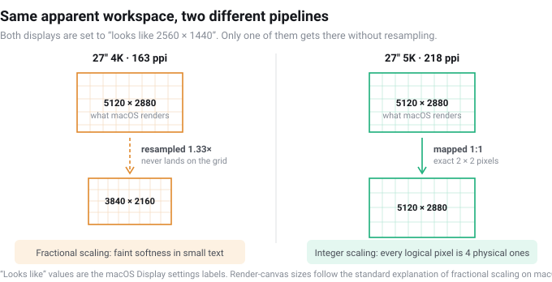

import ProductCard from '../../components/ProductCard.astro';

> **Based on** Apple's published specifications, linked in the text below: Studio Display (27″, 5120 × 2880, 218 ppi), 24-inch iMac (4480 × 2520, 218 ppi), Pro Display XDR (32″, 6016 × 3384, 218 ppi), MacBook Air 13-inch M4 (2560 × 1664, 224 ppi), and Apple's display-support page for the M4/M5 Air (support.apple.com/en-us/122212).\
> **My own setup** MacBook Air 13″, M4, 16 GB / 256 GB with one external display over HDMI through a cheap dock.
> **How this was researched** — an argument from arithmetic, built from the manufacturer spec pages linked in the text below. Every number is traceable to its source, and the product photos are the manufacturers' own.

## The short answer

| What you want | What to buy | ppi |
|---|---|---|
| Sharpest text, one display | **27″ 5K** (5120 × 2880) | **218** |
| Sharpest text, more room | **32″ 6K** (6016 × 3384) | 216 |
| Clean but compact | 24″ 4K (3840 × 2160) | 184 |
| Cheapest that works | 27″ 4K | 163 — expect soft text |
| Fine for video, poor for code | 32″ 4K | 138 |

If you are shopping for a Mac and reading this on a 27-inch 4K panel, the short version is: **you probably bought the most popular resolution in the world and the least suitable one for macOS.** It is not broken. It is being scaled in a way macOS handles worst, and the fix costs money.

## The number Apple builds its own screens around

Every Retina-class desktop display Apple sells sits at almost exactly the same pixel density:

| Apple display | Resolution | ppi |
|---|---|---|
| Studio Display, 27″ | 5120 × 2880 | **218** |
| 24″ iMac | 4480 × 2520 | **218** |
| Pro Display XDR, 32″ | 6016 × 3384 | **218** |
| MacBook Air 13.6″ (built-in) | 2560 × 1664 | 224 |
| MacBook Pro 14″ (built-in) | 3024 × 1964 | 254 |

That is not a coincidence and it is not a supply-chain accident. It is the density at which macOS's interface renders at **exactly 2×** — one logical pixel drawn as a clean 2 × 2 block of physical pixels. An older rule of thumb in the Mac community puts the two comfortable zones at roughly **110 ppi** (standard-density layout, comfortable at native scaling) and **220 ppi** (Retina layout, crisp at 2×). Apple only ever shipped the 220 end.

Which leaves a large, popular middle. A 27-inch 4K panel is about **163 ppi**. It is comfortably above the 110 zone and well below the 220 zone, and that is exactly where the complaints come from.

## What scaling actually does to a 27-inch 4K panel

macOS lets you choose a "looks like" resolution. Two of them matter on a 27-inch 4K screen, and both are a compromise:

**"Looks like 1920 × 1080."** This is a clean 2×. Every logical pixel becomes a 2 × 2 block, text is genuinely sharp — and you have thrown away the resolution you paid for. Your 4K monitor is now a 1080p monitor with very clean edges. On 27 inches, the interface is also physically large.

**"Looks like 2560 × 1440."** This is the mode most people run, and it is where the trouble is. It is a 1.5× target, not an integer multiple, so macOS renders the frame at **5120 × 2880** and then downscales the result into the panel's **3840 × 2160**. The image never lands on a pixel grid. Text and thin lines pick up a faint softness, and the extra rendering pass costs GPU and memory bandwidth.

A 27-inch 5K panel hits "looks like 2560 × 1440" as an exact 2× — 5120 physical columns for 2560 logical ones, four physical pixels per logical pixel, no resampling anywhere. Same apparent workspace as the 4K mode above, without the interpolation. That, and not marketing, is what the extra money buys.

## Why this is not a MacBook Air problem

It applies to every Mac, and it is worth saying plainly: **your MacBook Air M4 drives these resolutions without difficulty.** Apple's support page for the M4 and M5 Air lists, verbatim:

> "MacBook Air models with the M4 chip support up to two external displays simultaneously in addition to the built-in display."

Each external is capped at 6K (6144 × 3456) at 60Hz, or 4K at 144Hz. A single external goes higher still — 8K at 60Hz. So 5K and 6K are both inside the machine's bandwidth, and the choice between them is about money and desk space, not about whether the laptop can cope. If you want the longer version of what the M4 can drive and where the two-display advice online goes wrong, that is in [the dual-display article](/setup/macbook-air-m4-dual-display/).

## What the extra pixels cost, and what to skip

**27-inch 5K — the native answer.** This is the resolution macOS was designed around, and the one place where you get a comfortable workspace *and* clean text simultaneously. It is what Apple's own Studio Display is. Expect to pay for it.

**32-inch 6K — the same density, bigger.** 216 ppi, so the same story as the 27-inch 5K, on a much larger panel. Costs more again, and eats desk depth.

**24-inch 4K — the quiet option.** At 184 ppi this is not quite Apple's density, but it lands on a clean mode: "looks like 1920 × 1080" is an exact 2×, and on a 24-inch panel that size is reasonable rather than oversized. Sharp, honest, and it takes up less desk and less money than either option above. The cost is workspace — you are getting a very refined 1080p desktop.

**27-inch 4K — the compromise.** Covered above. It works, it is everywhere, and it is the cheapest way to get 1440p-class workspace. If most of what you do is video, a game, or one big window at a time, the softness in small text may never bother you. If you read code, spreadsheets or long documents, it is the wrong hundred dollars to save.

**32-inch 4K — the one to avoid for text.** About 138 ppi. At 2× that is a 1080p desktop on a 32-inch panel, which is oversized for most desk distances; at 1.5× you are back to non-integer scaling on an even bigger canvas. Fine as a television-adjacent display, poor as a text monitor.

## The Studio Display question

Apple's Studio Display is the reference point at $1,599, and it is a 27-inch 5K 218 ppi panel. It also includes a 12-megapixel camera, a three-microphone array and a six-speaker system.

Here is the part most comparisons skip: **your M4 MacBook Air already has a 12-megapixel Center Stage camera, a three-microphone array with beamforming, and a four-speaker system.** If the laptop is on your desk and open — which it is, because the M4 drives two externals alongside the built-in screen with the lid open — then the panel's built-in camera, microphones and speakers are duplicating hardware you already own and already use.

That reframes the purchase. If you are on a Mac mini, a monitor with camera and speakers attached is genuinely convenient. If you are on an M4 Air, the same features are largely redundant, and a **display-only 5K panel** is the more rational buy — you are paying for pixels instead of for a second copy of things the laptop already does better.

This is the segment Kuycon sells into: a brand built entirely around 27-inch 5K glossy panels at roughly half the Studio Display's price, with no camera, no microphones and no speakers.

## The monitors this logic points at

<ProductCard
  name="Kuycon P27Z — 27″ 5K glossy"
  verdict="The resolution and density this article argues for, at 180–330Hz — the highest refresh rate available at 5K, which no Apple display offers."
  basis="researched"
  image="https://m.media-amazon.com/images/I/414pexfWBYL._SS500_.jpg"
  imageAlt="The Kuycon P27Z, a 27-inch 5K glossy monitor on a honeycomb-pattern stand, shown from the front"
  affiliate={true}
  links={[{ label: 'Check current price', url: 'https://pboost.me/A5ilW2cd', store: 'Amazon' }]}
  pros={[
    '5120 × 2880 at 218 ppi — the exact density macOS is built around',
    'Glossy finish, matching the Studio Display look',
    'High refresh (180–330Hz) at 5K, which Apple does not sell at any price',
    'Display-only: DP, HDMI and USB-C inputs, no driver, no software',
  ]}
  cons={[
    'No camera, microphones or speakers — fine on an M4 Air, less so on a Mac mini',
    'Small brand with a short US track record; warranty and support are the open question',
    'Its own store prices these well below the US Amazon listing — check both before buying',
  ]}
/>

<ProductCard
  name="Kuycon G32X — 32″ 6K"
  verdict="216 ppi, so the same clean 2× logic as the 27-inch 5K, on a panel that gives you a lot more desk."
  basis="researched"
  image="https://m.media-amazon.com/images/I/31DA08qRBPL._SS500_.jpg"
  imageAlt="The Kuycon G32X, a 32-inch 6K monitor on a minimalist stand, shown from the front"
  affiliate={true}
  links={[{ label: 'Check current price', url: 'https://pboost.me/j5ilDNZct', store: 'Amazon' }]}
  pros={[
    '6016 × 3384 at 216 ppi — effectively the same density as the 27″ 5K',
    'Much more workspace than 27″, still inside what an M4 Air can drive',
  ]}
  cons={[
    'Needs real desk depth; 32 inches is close at normal viewing distance',
    'Same brand caveats as above — no camera, no speakers, short US track record',
  ]}
/>

<ProductCard
  name="Kuycon P27D — 27″ 4K"
  verdict="The compromise tier, bought deliberately: 163 ppi means non-integer scaling, and you should know that before you spend."
  basis="researched"
  image="https://m.media-amazon.com/images/I/71mzrbufwKL._AC_SL1500_.jpg"
  imageAlt="The Kuycon P27D, a 27-inch 4K glossy monitor on a minimalist stand, shown from the front"
  affiliate={true}
  links={[{ label: 'Check current price', url: 'https://pboost.me/s5ilIkc3', store: 'Amazon' }]}
  pros={[
    'Roughly $600 less than the 5K model for the same screen size',
    'Perfectly usable for video, games, and single-window work',
  ]}
  cons={[
    '163 ppi — macOS scales non-integer at 1440p-class workspace, so fine text softens',
    'If you read code or spreadsheets all day, this is the wrong place to save',
  ]}
/>

**On the prices:** these are US Amazon listings, and they are the one number in this article that changes weekly — check before you buy. Kuycon also sells direct from its own US store (kuycon.us), where the P27Z starts at **$1,399** against **$1,699.99** for the Amazon listing. A gap of roughly that size is close to what Amazon's referral fee and fulfilment add to any product it stocks, so it is not a warning sign about the brand — it is the cost of buying through a retailer that handles domestic shipping and returns. Ordering direct is usually the lower number; ordering the listing buys you a US return process on a $1,400 panel. Both are reasonable reasons to pick one over the other, and this is a category where a few minutes of comparison is worth real money.

## Before you buy, check four things

1. **Do the ppi arithmetic yourself.** Take the diagonal in pixels (√(width² + height²)), divide by the diagonal in inches. Under 150 and you are in the compromise zone; near 218 and you are at Retina density. Or let the [Mac monitor ppi and scaling calculator](/setup/mac-monitor-ppi-calculator/) do it, including which scaling mode macOS will pick. Do not trust "4K" or "5K" as a quality signal — a 32-inch 4K and a 14-inch laptop screen are both "4K".
2. **Read the macOS scaling options, not the spec sheet.** Search the model number plus "macOS scaling" and find out which "looks like" modes people actually run. A panel that only offers non-integer modes will look softer than its numbers suggest.
3. **Confirm it fits the ports you have.** Both of the M4 Air's Thunderbolt ports are free if you charge over MagSafe. One cable per display, straight in, no dock — see the dual-display article for why a cheap multi-output hub will make your two monitors mirror.
4. **Buy somewhere you can return it.** I have not tested these panels. Nobody's spec sheet covers panel lottery, backlight uniformity or how a specific unit behaves with your Mac. A return window is worth more than a review.

## Who this is for / who should skip it

**Worth reading if:**

- You are buying an external monitor for a MacBook Air (any generation) and were about to pick a 27-inch 4K because it is cheap and everywhere.
- You have a 27-inch 4K on a Mac already and something about the text has always felt slightly off. This is why.
- You are weighing a Studio Display and want to know what you are actually paying for.

**Skip it if:**

- You need colour-management guarantees, hardware calibration or a validated colour pipeline. That is a different purchase, and it is not one you should make from a ppi argument.
- You are buying for a Windows machine. Fractional scaling is handled differently there, and the 218 ppi logic does not transfer.
- You want a tested recommendation for one specific model. I have not used any of these. I can tell you what the arithmetic says a Mac wants; I cannot tell you which factory makes the best panel this month.

## Update log

- 2026-10-14 — first published, against Apple's published display specifications and the M4/M5 display support page. Affiliate links have not been added at the time of writing; if any are added later, this page will carry a disclosure at the top and this line will be updated.
