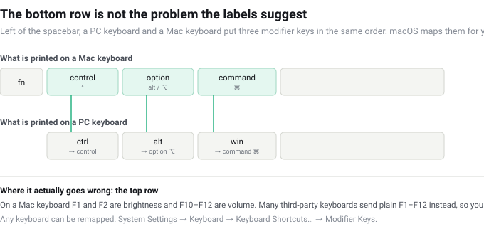

import ProductCard from '../../components/ProductCard.astro';

> **Based on** Apple's US accessory store prices (Magic Keyboard $99, with Touch ID $149, with Touch ID and numeric keypad $179, Magic Trackpad $129, Magic Mouse $79), Logitech's published specification for the MX Keys Mini, and the manufacturer's own Amazon listings for the CZUR K5S. Prices are US prices as listed on 14 October 2026 and move.
> **My own setup** MacBook Air 13″, M4, 16 GB / 256 GB, on a stand with one external display. **I have not bought or tested any of the keyboards below.** Nothing here is a hands-on claim — it is a checklist built from spec sheets and published prices, and every figure is traceable to the page it came from.
> **The product photo** on the budget card is the manufacturer's own, loaded from its Amazon listing. It shows what the thing looks like; it is not a picture of anything on my desk.

## The short answer

| Your situation | What to do |
|---|---|
| MacBook open on the desk | **Nothing.** See the next section |
| Closed lid, or a stand high enough to put the built-in keyboard out of reach | You need one — this is the only mandatory case |
| You also drive an iPad or a second computer | Get one with a three-device switch |
| Dark room | Backlight is the feature worth paying for |
| Typing *and* pointing, as cheaply as possible | The one-piece budget option, with real limits |

If you skim only one line: **the most common reason to buy an external keyboard is not that the MacBook's is bad. It is that the laptop ended up somewhere the keyboard no longer reaches.**

## The keyboard you already have

A MacBook Air ships with a backlit keyboard and, more to the point, the best trackpad in the industry, both wired to the machine. If it sits open in front of you — flat, or on a low riser — you already own a better input setup than most of this article is about, and buying a second one is a downgrade in everything but position.

That "but position" is the whole question. Two situations change the answer:

- **The lid is closed.** In clamshell mode the built-in keyboard and trackpad are simply gone. This is the one case where a second keyboard is mandatory rather than optional.
- **The laptop is on a tall stand.** Reaching past the screen to type on an angled keyboard is the thing people actually complain about. If your external display is at eye level and the MacBook is underneath it, you are in this group.

If neither applies, this is the cheapest article you will read this month: the answer is nothing.

## Four things that change when the keyboard is not Apple's

Once you have decided you need one, the decision is not "which keyboard feels nicest". It is how many of these four macOS-specific behaviours you are willing to work around.

### 1. The modifier legends are wrong, but the positions are not

This is the most over-feared difference and it is mostly cosmetic. Left of the spacebar, both layouts put three modifiers in the same order:

macOS remaps a standard PC keyboard on connection: the key next to the spacebar becomes Command, the one before it Option, the leftmost Control. Your fingers land where they expect. What you lose is the printed legend — you read *alt* where you meant ⌥ — and if that bothers you, **System Settings → Keyboard → Keyboard Shortcuts… → Modifier Keys** will remap any connected keyboard, including the built-in one.

### 2. The function row is where it actually breaks

On a Mac keyboard, F1 and F2 are brightness, F10 to F12 are volume. Many third-party keyboards send plain F1–F12 on that row instead, so the shortcut needs Fn held down — and some models have no Fn lock, which means holding it forever. **This, not the missing ⌘ key, is what separates a keyboard that feels native from one that fights you.** Check it in the manual before buying; it is rarely in the marketing copy.

### 3. How it wakes up

Apple's keyboards wake on a keypress and are ready. Cheaper Bluetooth models sleep after a few minutes and need a keypress to come back — the CZUR K5S states in its own listing that a tap on its touchpad will **not** wake it. If the keyboard lives across the desk from you, that is a small friction, several times an hour, forever.

### 4. A third-party trackpad will not do what your MacBook's does

This is the one people discover after buying. macOS gestures — three-finger drag, four-finger swipe between full-screen apps, pinch to zoom, Mission Control — need hardware that reports multiple simultaneous touches, and the system-level ones effectively mean Apple's own trackpad. Apple's Magic Trackpad is $129. A mouse is $79 and does the job.

The corollary matters for the budget end: a keyboard with a built-in touchpad gives you scrolling, clicking and cursor movement. **It does not give you the gesture layer**, and no amount of configuration adds it.

## The checklist before you buy

| Question | Why it decides the purchase |
|---|---|
| Does it have an explicit Mac mode, or will you remap it yourself? | Tells you whether the Fn row and media keys will behave |
| How many devices does it pair with? | One at a time is normal at the cheap end; three with a switch button starts around $100 |
| Backlight? | Costs battery life, and it is the single feature that separates price tiers here |
| Number pad? | A compact layout keeps the mouse closer and your shoulders straighter |
| Does it ship with a cable you can type on? | The difference between "flat battery" and "back to the laptop keyboard" |
| What size are the keycaps? | Compact keyboards shrink them; read the listed dimensions rather than the photo |

## What each price step buys

| Price | What you get | Who it is for |
|---|---|---|
| **$33–39** | One-piece keyboard with a built-in touchpad, 81 keys, no backlight, one device at a time | Media, travel, a second machine — see the card below |
| **$79** | Apple Magic Mouse | You only need pointing, not typing |
| **$99** | Apple Magic Keyboard — native layout, no Touch ID, no backlight | You want zero decisions and a native Fn row |
| **$99.95** | Logitech MX Keys Mini — backlight, three devices, key mapping that follows the paired computer | The step that actually changes the experience |
| **$129 / $149 / $179** | Magic Trackpad / Magic Keyboard with Touch ID / with Touch ID and numeric keypad | The full gesture set, or Touch ID, or a number pad |

## The three I would shortlist

<ProductCard
  name="CZUR K5S — keyboard with touchpad"
  verdict="The cheapest way to get typing and pointing in one device. Judge it against that, not against a $149 keyboard: it is a media and travel keyboard, and as a daily typing keyboard for a Mac it has limits you can read before you buy."
  basis="researched"
  image="https://m.media-amazon.com/images/I/31TOZb5Gu2L._SS500_.jpg"
  imageAlt="The CZUR K5S, a compact wireless keyboard with a touchpad on its right-hand side, shown from above"
  affiliate={true}
  links={[
    { label: 'The $33 listing', url: 'https://pboost.me/J5hV6NcMv', store: 'Amazon' },
    { label: 'The $39 listing', url: 'https://pboost.me/E5hVMcM4', store: 'Amazon' },
  ]}
  pros={[
    'A keyboard, a touchpad and media keys in one unit, for less than the price of a mouse',
    'Bluetooth or wired USB — the cable is the fallback when the battery is flat',
    'An explicit Mac mapping on FN + A, so the key layout is at least deliberate',
    'Thin and light enough to live in a bag, and it charges over USB-C',
  ]}
  cons={[
    'Pairs with one device at a time — no switching between a MacBook and an iPad',
    'Two-finger scrolling only; the three- and four-finger macOS gestures are not there',
    'The touchpad will not wake it, so you press a key first (stated in its own listing)',
    'No backlight, and the keycaps are smaller than a standard keyboard',
  ]}
/>

<ProductCard
  name="Logitech MX Keys Mini — $99.95"
  verdict="The price step where the experience actually changes: backlight, three paired devices, and a keyboard that adapts its own key mapping to whichever computer it is connected to."
  basis="researched"
  pros={[
    'Pairs with up to three devices and switches between them with a dedicated button',
    'Backlight that comes on as your hands approach, rather than staying lit',
    'Detects the connected OS and shows Command and Option on macOS, Ctrl and Alt elsewhere',
    'USB-C charging: about ten days per charge with the backlight on, five months with it off',
  ]}
  cons={[
    'Compact layout, so there is no number pad',
    'Around $60 more than the budget option for the same footprint',
    'Whatever you customise lives in Logi Options+, not in the keyboard itself',
  ]}
/>

<ProductCard
  name="Apple Magic Keyboard with Touch ID — $149"
  verdict="The no-decisions option, and the only one on this list that is guaranteed to behave exactly like the keyboard you already have — minus the backlight, which Apple does not offer on any of them."
  basis="researched"
  pros={[
    'Native layout, native function row, no remapping to do',
    'Touch ID for logins, password fills and payments on Macs with Apple silicon',
    'About a month or more per charge, paired to your Mac automatically',
  ]}
  cons={[
    'No backlight at any price in this line',
    'No three-device switch — there is no quick toggle between Macs',
    '$149 for a keyboard without backlight or multi-device support',
  ]}
/>

**On the prices:** these are US list prices as I found them on 14 October 2026, and they move — check before you buy. The two cheaper tiers are frequently discounted: Logitech's own keyboard was listed on Amazon at $89.99 against a $99.99 list price when I checked, and the budget one-piece exists under two listings for the same hardware at $33 and $39, which is worth knowing before you buy the more expensive of the two.

## What I would actually do

If the MacBook spends most of the day closed or on a tall stand, this is not a category worth optimising: pay the $99–$149, get a native function row and stop thinking about it.

If what you want is a keyboard for the couch, for travel, or for a machine you occasionally drive from the sofa, the $39 one-piece is a legitimate answer and nothing more expensive is better at that job — it is one device instead of two, and that is its entire argument.

And if you are not sure you need one at all, re-read the second section. That is the honest answer more often than the rest of this page is.
